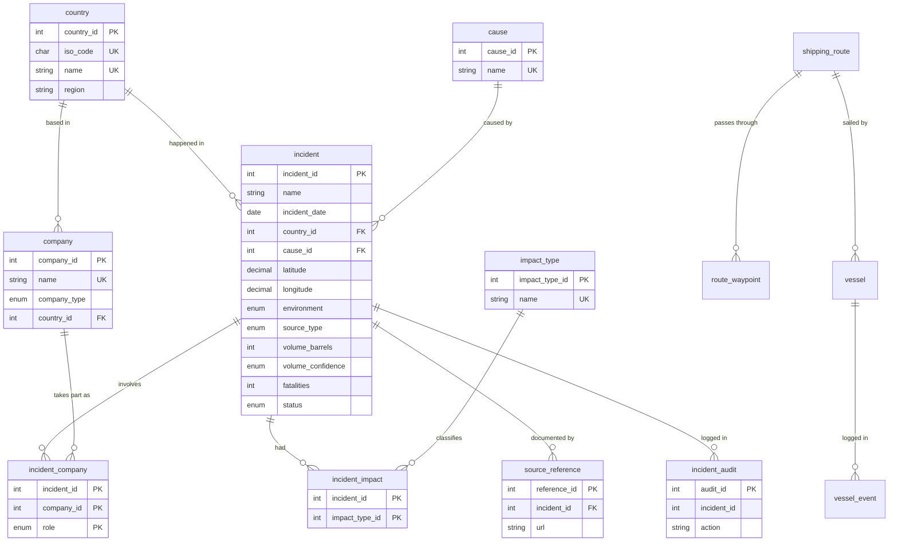

# Oil Leaks Database

An open-source relational database of oil spills and leaks around the world: tankers, pipelines, offshore platforms, wells, storage facilities and rail, on land, in freshwater and at sea.

**Live site:** https://yashas-0507.github.io/oil-leaks/ (interactive map and charts, a 3D **Ship Tracker** globe, and a SQL Lab where you can run any query and even alter the tables, right in the browser)

Started as a DBMS course project. Code is MIT licensed, data is CC BY 4.0, contributions are welcome.

## What is in the box

| Path | What it is |
| --- | --- |
| `data/*.csv` | The dataset. One CSV per table, the single source of truth |
| `db/mysql/schema.sql` | MySQL 8 schema: tables, constraints, indexes, views, triggers, a function and a stored procedure |
| `db/mysql/seed.sql` | Generated `INSERT`s for MySQL (built from `data/`) |
| `db/sqlite/schema.sql` | SQLite version of the schema, used by the website |
| `db/queries.sql` | 14 sample queries (joins, GROUP BY/HAVING, subqueries, window functions, CTE) |
| `scripts/build.py` | Validates the CSVs and builds `web/oil_leaks.db` and `db/mysql/seed.sql` |
| `web/` | The static website (map, charts, 3D globe, SQL Lab). Runs real SQLite in the browser via sql.js |

## Ship Tracker (3D globe)

The **Ship Tracker** tab shows 50 *fictional* ships sailing along real sea lanes on a 3D globe: **green** = running, **yellow** = stalled (traffic, awaiting orders, weather), **red** = leaking. It is a simulation, not live AIS data. The `vessel` table is the source of truth: the simulation reads it, moves the ships and writes positions and status changes back with SQL `UPDATE`s, and a trigger logs every change to `vessel_event`. Run `UPDATE vessel SET status = 'leaking' WHERE vessel_id = 5;` in the SQL Lab, switch back to the globe, and the ship turns red.

## Entity-relationship diagram



`incident_company` and `incident_impact` are the many-to-many junction tables. The fleet tables (`shipping_route`, `route_waypoint`, `vessel`, `vessel_event`) power the globe. The tables are in third normal form: countries, causes, companies and impact types are stored once and referenced by key.

## Run it yourself

### MySQL (for the DBMS demo)

```powershell
mysql -u root -p < db/mysql/schema.sql
mysql -u root -p oil_leaks < db/mysql/seed.sql
mysql -u root -p oil_leaks < db/mysql/queries.sql
```

Then try the stored procedure and function:

```sql
USE oil_leaks;
CALL sp_top_spills_by_country('US', 5);
SELECT name, fn_barrels_to_tonnes(volume_barrels) AS tonnes FROM incident LIMIT 5;
```

Requires MySQL 8.0.16 or newer (for `CHECK` constraints). The MySQL files have not been run against a live MySQL server in the automated checks, so if something fails on your version please open an issue.

### The website locally

```powershell
python scripts/build.py
python -m http.server 8000 -d web
```

Open http://localhost:8000. The SQL Lab accepts `SELECT`, `INSERT`, `UPDATE`, `DELETE`, `CREATE`, `ALTER`, `DROP`, transactions, triggers and views. Changes are kept in your browser only; **Reset database** restores the original.

Note that the website uses SQLite, so a few things differ from MySQL: for example `ALTER TABLE ... MODIFY` is not available and the stored procedure and function exist only in the MySQL version.

## Contributing data

1. Add or fix rows in the CSV files in `data/` (new spills go in `incidents.csv`, add companies, references and impacts in their files).
2. Run `python scripts/build.py`. It checks foreign keys, dates, coordinates and URLs.
3. Open a pull request with a source link for any new or changed figure.

Volumes are in barrels. `volume_confidence` says how much to trust the number (`low`, `medium`, `high`); leave `volume_barrels` empty when no reliable estimate exists. Coordinates are approximate locations.

## Data quality

The seed dataset covers 42 well-known incidents compiled from public sources. Estimates for many historical spills differ between sources, and some figures here are rounded. Treat it as a starting point and verify against primary sources (government agencies, court records, scientific papers) before citing. Corrections are very welcome.

## License

Code: [MIT](LICENSE). Data in `data/`: [CC BY 4.0](DATA_LICENSE.md). Bundled libraries (sql.js, Leaflet, globe.gl, topojson-client, world-atlas) keep their own licenses in `web/vendor/`.
